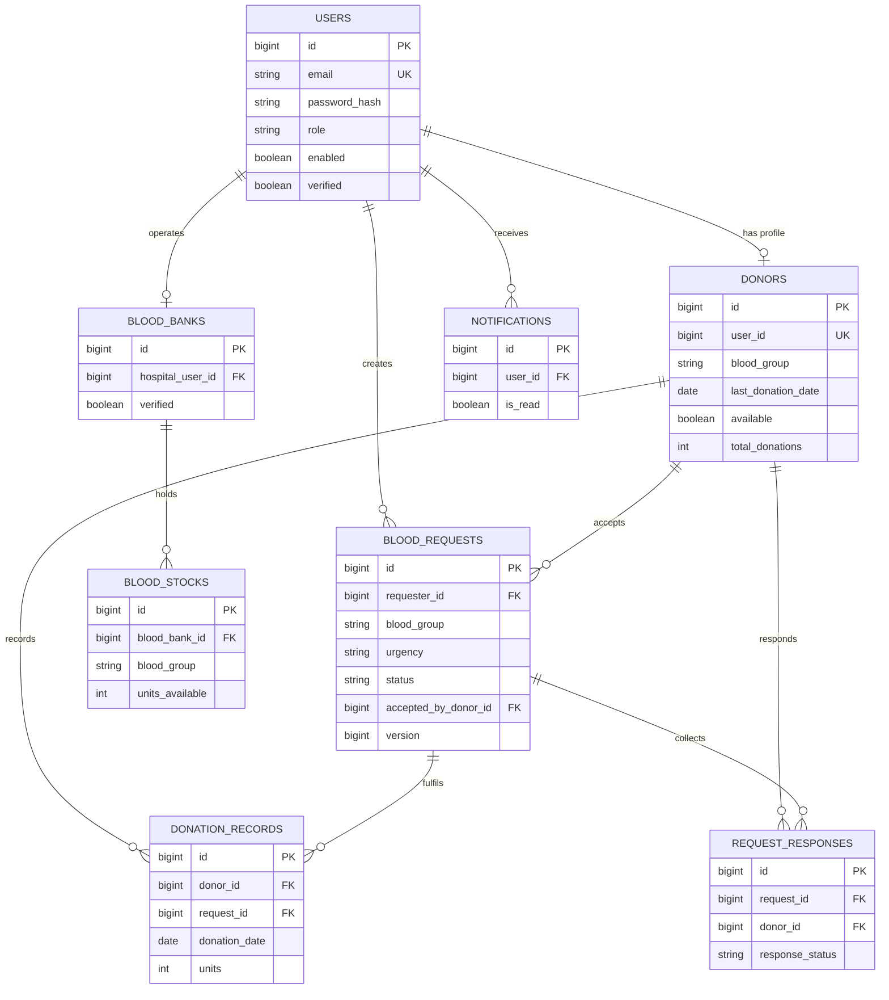

# Blood Donation Finder and Emergency Request System

College end-semester Java full-stack application that connects blood donors with recipients, hospitals, and blood banks. Matching uses red-blood-cell compatibility, city and area, donor availability, a configurable 90-day eligibility interval, and account verification.

The 90-day interval is a project assumption. It is not a universal medical eligibility rule. Final compatibility and donation suitability must be confirmed by qualified medical professionals and the blood bank.

## Problem statement

During emergencies, families often search for a compatible donor by phone and social media. Contact details are shared too widely, searches ignore recent donation dates, and hospitals have no shared view of nearby stock. This system keeps donor phone numbers private until a donor accepts a request, and it records the request through fulfilment.

## Features

- Donor, requester, hospital, and administrator roles with Spring Security.
- Donor registration, profile editing, availability toggle, eligibility date, incoming requests, and donation history.
- Recipient search by blood group, city, and area, plus normal, urgent, and emergency requests.
- Contact details are shown only after a donor accepts.
- Optimistic locking so a single-donor request cannot be accepted twice.
- Donation records update last donation date and total donations when a request is fulfilled.
- Scheduled expiry of requests whose required-by date has passed.
- Blood-bank stock by group, city search, and low-stock highlighting below five units.
- Admin verification, account blocking, request monitoring, Chart.js reports, and CSV export.
- In-app notifications. Email is optional and the application still starts when mail is not configured.
- H2 in-memory database by default, with a MySQL profile and Flyway migrations.

## Technology stack

| Layer | Technology |
| --- | --- |
| Language | Java 17 (compiled with `--release 17`; runs on JDK 17 or 21) |
| Backend | Spring Boot 3.3.5, Spring MVC, Spring Data JPA, Hibernate, Validation, Mail, Scheduling |
| Security | Spring Security, BCrypt, CSRF, role-based access |
| Frontend | Thymeleaf, HTML5, CSS3, JavaScript, Bootstrap 5, Bootstrap Icons, Chart.js (CDN) |
| Database | H2 (default), MySQL 8.4 (profile `mysql`) |
| Migrations | Flyway (`ddl-auto=validate`, so Hibernate does not alter the schema) |
| Build | Maven |
| Tests | JUnit 5, Mockito, Spring Boot Test |

## Architecture

```
Browser (Thymeleaf)
    -> Controller
    -> Service interface
    -> Service implementation
    -> Spring Data repository
    -> JPA entity / Flyway schema
```

Packages under `com.bloodfinder`:

- `config` — security and demo seeding
- `controller` — MVC endpoints
- `dto` — validated form objects
- `entity`, `enums`, `repository`
- `service` and `service.impl`
- `security` — user details and role-based login redirect
- `util` — `BloodCompatibilityUtil`
- `exception` — `ResourceNotFoundException`, `DonorNotEligibleException`, `DuplicateRequestException`, `UnauthorizedActionException`, and a `@ControllerAdvice` handler

Business rules live in services. Controllers validate input, call services, and choose a view.

## Database design

Flyway script: `src/main/resources/db/migration/V1__Initial_Schema.sql`. A reference copy is `schema.sql`.



`blood_stocks` has a unique constraint on `(blood_bank_id, blood_group)`. `donation_records.request_id` is nullable so historical walk-in donations can be stored without an in-app request.

## Required software

- JDK 17 or newer (the project compiles to Java 17 bytecode). A JDK is bundled at `.tools/jdk` for this workspace, and `mvnw.cmd` uses it.
- Maven 3.9+. Use `mvnw.cmd` in this folder if Maven is not on `PATH`. The wrapper points at `.tools/apache-maven-3.9.9` and a local repository under `.tools/.m2`.
- A browser.
- MySQL 8.4 only when you use the `mysql` profile. H2 needs no installation.

## Run with H2 (default)

From the project directory:

```bat
mvnw.cmd spring-boot:run
```

If Maven is already installed and `JAVA_HOME` points at JDK 17+:

```bat
mvn spring-boot:run
```

Open `http://localhost:8080`.

The active profile is `h2` (`application.properties`). The database is in-memory, so data resets when the process stops. Flyway creates the schema. `DataSeeder` inserts demo rows only when `users` is empty.

H2 console (development): `http://localhost:8080/h2-console`

- JDBC URL: `jdbc:h2:mem:bloodfinder_db`
- User: `sa`
- Password: empty

## Run with MySQL 8.4

1. Create the database:

```sql
CREATE DATABASE bloodfinder_db CHARACTER SET utf8mb4 COLLATE utf8mb4_unicode_ci;
```

2. Set environment variables. Do not commit real passwords.

```bat
set DB_URL=jdbc:mysql://localhost:3306/bloodfinder_db?useSSL=false&allowPublicKeyRetrieval=true&serverTimezone=UTC
set DB_USERNAME=your_user
set DB_PASSWORD=your_password
mvnw.cmd spring-boot:run -Dspring-boot.run.profiles=mysql
```

`application-mysql.properties` reads `DB_URL`, `DB_USERNAME`, and `DB_PASSWORD`. If they are omitted, it falls back to `localhost:3306/bloodfinder_db`, user `root`, and an empty password for a local demo only. Change that before any shared deployment.

Flyway owns the schema (`spring.jpa.hibernate.ddl-auto=validate`). Hibernate checks the schema and does not create or alter tables.

## Default demo credentials

These accounts are seeded for development and viva demonstration. Change them before any real deployment. All names, emails, and phone numbers are fictional.

| Role | Email | Password |
| --- | --- | --- |
| Administrator | `admin@bloodfinder.com` | `Admin@123` |
| Donor | `kiran.a_pos@example.com` | `Donor@123` |
| Donor (O+, eligible, Vijayawada) | `ananya.o_pos@example.com` | `Donor@123` |
| Requester | `ravi.recipient@example.com` | `User@123` |
| Hospital | `citycare.vja@example.com` | `Hospital@123` |

Other seeded donors use `Donor@123`. `lakshmi.a_neg@example.com` is unverified and cannot sign in. `tarun.ab_pos@example.com` is disabled and cannot sign in. New hospitals stay unverified until an administrator approves them. Donor and requester self-registration is marked verified so a classroom demo can continue immediately; an administrator can still block those accounts.

There is no public administrator registration.

## Application URLs

Base URL: `http://localhost:8080`

| Page | Path |
| --- | --- |
| Home | `/` |
| About | `/about` |
| Find donors | `/find-donors` |
| Blood banks | `/blood-banks` |
| Login / logout | `/login`, `/logout` |
| Register | `/register`, `/register/donor`, `/register/requester`, `/register/hospital` |
| Access denied | `/access-denied` |
| Donor dashboard | `/donor/dashboard`, `/donor/profile`, `/donor/edit-profile`, `/donor/requests`, `/donor/history`, `/donor/notifications` |
| Requester dashboard | `/requester/dashboard`, `/requester/create-request`, `/requester/requests`, `/requester/requests/{id}`, `/requester/matching-donors`, `/requester/notifications` |
| Hospital dashboard | `/hospital/dashboard`, `/hospital/stock`, `/hospital/raise-request`, `/hospital/requests` |
| Admin dashboard | `/admin/dashboard`, `/admin/donors`, `/admin/users`, `/admin/requests`, `/admin/blood-banks`, `/admin/verifications` |
| CSV export | `/admin/reports/csv` |
| Shared notifications | `/notifications` |

Homepage statistics (donor count, request count, fulfilled count) are read from the database.

## Testing

```bat
mvnw.cmd test
```

Covered areas:

- `BloodCompatibilityUtil` for all eight groups, including incompatible pairs.
- Donor eligibility: no prior donation, under 90 days, exactly 90 days, over 90 days, unavailable, unverified, and disabled.
- Request create, duplicate prevention, accept, double-accept prevention, reject, cancel, fulfil, and expire.
- Stock create, update, and negative-stock prevention.
- BCrypt, role authorities, blocked login, and unverified login.

The latest local run completed with **34 tests, 0 failures**.

## Screenshots

Capture these from the running H2 application for the project report file. Suggested filenames under `docs/screenshots/`:

1. `01-home.png` — landing page with live statistics.
2. `02-find-donors.png` — donor search for O+ in Vijayawada.
3. `03-donor-dashboard.png` — eligibility and availability.
4. `04-incoming-requests.png` — accept or reject.
5. `05-requester-request.png` — emergency request form.
6. `06-request-accepted.png` — contact details after acceptance.
7. `07-hospital-stock.png` — stock table with low-stock highlight.
8. `08-admin-dashboard.png` — Chart.js reports.
9. `09-admin-verify.png` — verification queue.
10. `10-access-denied.png` — a donor opening `/admin/dashboard`.

## Viva demonstration script

1. Start with `mvnw.cmd spring-boot:run` and open `http://localhost:8080`.
2. Show live counts on the home page, then search donors on Find Donors. Point out the medical disclaimer.
3. **Donor.** Sign in as `ananya.o_pos@example.com` / `Donor@123`. Open the profile, toggle availability, and read the next eligibility date. Open Incoming Requests, accept the open O+ emergency in Vijayawada, then open Donation History (historical walk-in rows have no linked request).
4. **Requester.** Sign out. Sign in as `ravi.recipient@example.com` / `User@123`. Search matching donors, create an emergency request, open the request, and show that a phone number appears only after acceptance. After a donation is recorded, confirm fulfilment.
5. **Hospital.** Sign in as `citycare.vja@example.com` / `Hospital@123`. Open stock, change a blood-group unit count (zero is allowed; negative is rejected), and raise a request.
6. **Admin.** Sign in as `admin@bloodfinder.com` / `Admin@123`. Show dashboard charts, verify or reject a pending hospital, block a suspicious user, cancel or review requests, and download `/admin/reports/csv`.
7. Show that `lakshmi.a_neg@example.com` / `Donor@123` cannot sign in, and that a donor who opens `/admin/dashboard` reaches the access-denied page.

### Points to defend

- **OOP.** Entities encapsulate state. Services implement interfaces (polymorphism). Enums restrict role, blood group, urgency, and status. `BloodCompatibilityUtil` is a stateless utility. Custom exceptions separate domain failures from HTTP handling.
- **Spring Boot.** Controllers are thin. `@Transactional` boundaries wrap accept and fulfil. `@Version` on `BloodRequest` is the optimistic lock. `@Scheduled` expires overdue requests. `@ControllerAdvice` maps exceptions to pages.
- **Security.** BCrypt hashes are stored, never the raw password. CSRF is on for browser forms. `hasRole` rules split `/admin`, `/donor`, `/requester`, and `/hospital`. `CustomUserDetails` refuses disabled and unverified users. Login redirects by role.
- **Privacy.** Public donor search does not render phone numbers. The requester sees the accepting donor's phone only on an accepted or fulfilled request they own.
- **Eligibility.** `app.donor.eligibility-days=90`. Availability alone does not make a recent donor appear in search results.

## Future scope

- Real SMTP templates and SMS for emergencies.
- Aadhaar or hospital-ID verification instead of admin-only review.
- Platelet and plasma compatibility, which differ from red-cell rules.
- Geo-distance ranking instead of city and area text match.
- Audit log and two-factor login for administrators.
- Persistent H2 or MySQL in the default demo profile so data survives restart.
